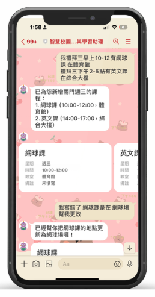
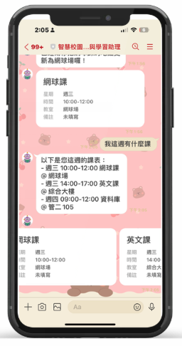
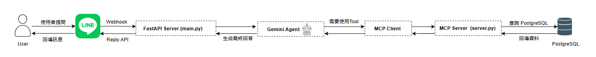

# 🎓 LINE 智慧校園課表與學習助理

> 用自然語言在 LINE 紀錄課表、查課表、找教室、記作業、查空堂。
> 以 **FastAPI + MCP (Model Context Protocol) + LINE Messaging API + Gemini** 打造，並以 **Flex Message** 呈現視覺化課表卡片。


##  Demo




## ✨ 功能特色

- 🗣️ **自然語言互動**：不用記指令，直接問「星期三有什麼課？」「資料庫在哪間教室？」
- 🧰 **MCP Server 封裝課表工具**：將資料操作抽成標準化 Tools，AI 可自行判斷要呼叫哪一個
- 🤖 **LLM 自主決策（Tool Calling）**：由 Gemini 決定呼叫哪個 Tool，拿到結果後再潤飾成口語回覆
- 🎨 **Flex Message 課表卡片**：查詢課表時回傳視覺化卡片，而非純文字
- 🛡️ **例外處理與防呆**：AI 聽不懂、查無資料、Tool 執行失敗時皆有友善回覆

## 🏗️ 系統架構



**資料流程**

1. 使用者在 LINE 傳送訊息，LINE Platform 以 Webhook 通知 FastAPI
2. FastAPI 驗證簽章後，將訊息與 MCP Server 提供的 Tool 清單交給 Gemini
3. Gemini 判斷意圖並決定要呼叫的 Tool 與參數
4. FastAPI 內的 MCP Client 呼叫 MCP Server 執行 Tool，並從 SQLite 取得資料
5. 結果回傳 Gemini 產生口語回覆；若為課表查詢，則填入 Flex Message 模板
6. 透過 LINE Reply API 回覆使用者

## 🧰 MCP Tools

| Tool | 說明 | 範例問法 |
|---|---|---|
| `get_schedule` | 查詢某天的課表 | 「星期三有什麼課？」 |
| `add_course` | 新增修課資訊 | 「幫我記禮拜三早上9-12點資料庫在管二上課，而且下週三要交報告」 |
| `update_course_note` | 更新特定課程的備註（例如作業提醒、調課通知、考試時間） | 「星期五下午有考試？」 |

## 🛠️ 技術選型

| 類別 | 技術 |
|---|---|
| Web Framework | FastAPI, Uvicorn |
| AI Tool Protocol | MCP Python SDK（Server + Client） |
| LLM | Google Gemini API（Google AI Studio） |
| Messaging | LINE Messaging API, Flex Message |
| Database | SQLite |
| Deployment | Render |

## 📁 專案結構

> 請依實際結構調整

```
.
├── main.py                  # FastAPI 入口
|server.py                   # MCP Server 與 4 個 Tools
│init_db.py                  # 初始化資料庫
├── requirements.txt
├── .env.example
└── README.md
```

## 🚀 快速開始

### 1. 安裝

```bash
git clone https://github.com/LIU-CHENGYA/line-mcp-schedule.git
cd <your-repo>
python -m venv .venv && source .venv/bin/activate
pip install -r requirements.txt
```

### 2. 設定環境變數

複製 `.env.example` 為 `.env` 並填入：

```env
LINE_CHANNEL_SECRET=your_line_channel_secret
LINE_CHANNEL_ACCESS_TOKEN=your_line_channel_access_token
GEMINI_API_KEY=your_gemini_api_key
```

### 3. 初始化資料庫

```bash
python init_db.py
```

### 4. （可選）用 MCP Inspector 單獨測試 MCP Server

```bash
npx @modelcontextprotocol/inspector python mcp_server/server.py
```

### 5. 啟動服務

```bash
uvicorn app.main:app --reload --port 8000
```

本機開發可搭配 ngrok，並將 `https://<ngrok-url>/callback` 設定為 LINE Developers 後台的 Webhook URL。

## ☁️ 部署（Render）

1. 於 Render 建立 **Web Service** 並連結此 GitHub Repo
2. Build Command：`uv sync`
3. Start Command：`uvicorn app.main:app --host 0.0.0.0 --port $PORT`
4. 在 Environment 設定上述三個環境變數
5. 將 `https://<your-service>.onrender.com/callback` 填入 LINE Webhook URL 並啟用 Use webhook

> ⚠️ Render 免費方案閒置會休眠，首次訊息可能延遲數十秒。

## 🛡️ 例外處理

- **LINE 簽章驗證**：拒絕非 LINE 平台來源的請求
- **AI 無法判斷意圖**：回覆引導訊息，提示可用的功能與範例問法
- **查無資料**：明確告知（例如「星期六沒有課」），不讓 LLM 憑空捏造
- **Tool 執行失敗／LLM 逾時**：捕捉例外並回覆友善錯誤訊息，同時記錄 log
- **參數驗證**：星期、時段等輸入在 Tool 內做格式檢查

## 💡 設計重點與心得

- **為何用 MCP？** 將「資料操作」與「對話邏輯」解耦：Tool 只需寫一次，即可被 Claude Desktop、MCP Inspector 或自建 Client 共用，日後擴充功能（如接校務系統）不需改動 Agent 邏輯。
- **Flex Message 與 LLM 分工**：結構化資料（課表）由後端直接填入模板以確保版面穩定；LLM 負責理解意圖與口語化說明，避免讓模型直接產生 JSON 造成格式錯誤。
- **挑戰**：<!-- 例：處理 MCP Client 在 FastAPI async 環境下的連線生命週期 -->
- **未來規劃**：串接校務系統自動同步課表、定時推播上課／作業提醒、多使用者資料隔離


## 👤 Author

**劉承亞** ・ [GitHub](https://github.com/LIU-CHENGYA/line-mcp-schedule) ・ a0900192309@gmail.com